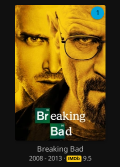
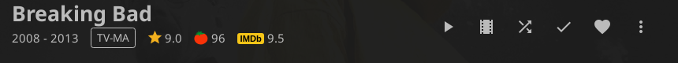

# IMDb Ratings for Ferrofin

A [Ferrofin](https://github.com/mangoleaf/ferrofin) plugin that shows IMDb
ratings in the web client:

- on movie and series cards, after the year
- on movie and series pages, next to the community and critic ratings

<p>
  
  
</p>

Hover a rating to see its vote count. Titles with no IMDb rating show nothing.
No API key, no configuration.

## Requirements

- Ferrofin with plugin ABI `ferrofin:plugin@0.5.0` (Ferrofin 1.3.x). Tested on
  Ferrofin v1.3.2 with jellyfin-web 12.0.0.
- The built-in **File Transformation** plugin enabled (it is by default). It
  adds this plugin's script to the web client.
- Your server can reach `datasets.imdbws.com` over HTTPS.

Only the web client shows the ratings, in a browser or in apps that wrap it.
Apps with their own interface (Android TV, Swiftfin, Infuse, Kodi) don't.

## Install

In Ferrofin: **Dashboard → Plugins → Repositories → +**, and add

```
https://minde.github.io/ferrofin-imdb-ratings/manifest.json
```

Then **Catalog → IMDb Ratings → Install**, restart Ferrofin, and reload the
web client. Updates arrive through the same repository.

Without the repository: download `imdb_ratings.wasm` from
[Releases](https://github.com/minde/ferrofin-imdb-ratings/releases), copy it
into `{data_dir}/plugins/` (`/data/plugins/` in the Docker image), and restart.

## Where the ratings come from

IMDb's [ratings dataset](https://developer.imdb.com/non-commercial-datasets/),
which IMDb refreshes daily. Your server downloads it (about 8.5 MB) the first
time a page needs a rating, and again when a rating is a day old. It never
downloads more than once an hour, and a download takes well under a second to
read. The dataset is licensed for **personal, non-commercial use**; that is
your server, and your use.

Ratings are matched by the IMDb id your library already has for each title
(from TheMovieDb or another metadata provider). If a title shows the wrong
rating, or none, its metadata matched the wrong title: fix it with
**Identify** or **Edit metadata**.

## What this plugin can access

Ferrofin plugins run in a sandbox with no file or network access of their own.
This one uses:

| Access | Why |
| --- | --- |
| HTTPS to `datasets.imdbws.com` only (`egress` in `Cargo.toml`, enforced by Ferrofin) | the ratings dataset |
| A script added to the web client for every user | to draw the ratings |
| Its own small key/value store | ratings it has shown, so a restart doesn't need a download |

The script ([`src/client.js`](src/client.js)) reads the IMDb ids of the
movies and series on screen through Ferrofin's normal API, with the signed-in
user's session, and asks the plugin for their ratings. The rating route only
answers signed-in users. Nothing leaves your server except the dataset
download.

Disabling the plugin stops the ratings straight away; the script tag itself
is removed at the next restart.

## Build from source

Needs only [`rustup`](https://rustup.rs). The pinned toolchain and the
`wasm32-wasip2` target install themselves on the first build.

```bash
./test.sh    # unit tests, on the host
./build.sh   # dist/imdb_ratings.wasm
```

`src/ratings.rs` parses the dataset, `src/lib.rs` is the plugin (download,
cache, HTTP routes, the script tag), and `src/client.js` runs in the browser.

## Releasing

Bump `version` in `Cargo.toml`, add an entry to [CHANGELOG.md](CHANGELOG.md),
and push to `main`. The release workflow tests, builds and publishes a
`vX.Y.Z` GitHub Release, then regenerates the repository manifest on GitHub
Pages.

## License

GPL-3.0-only, like Ferrofin, whose plugin interface (`wit/`) this is built
against. See [LICENSE](LICENSE). IMDb is a trademark of IMDb.com, Inc.; this
project is not affiliated with IMDb.
